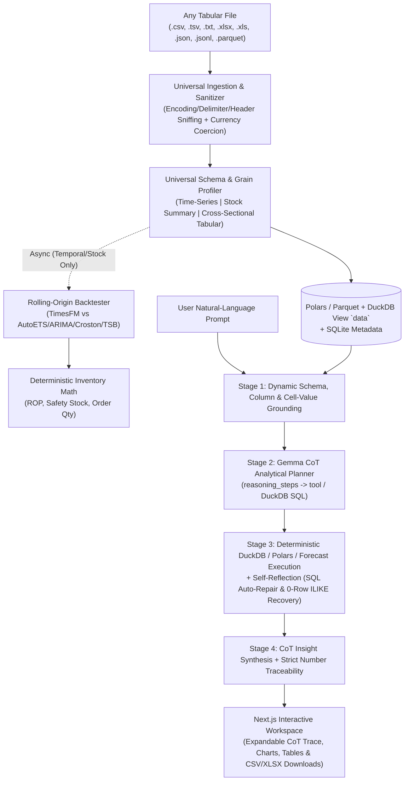

# Local AI Data Analyst, Forecasting & Decision Engine

A **100% local-first AI Data Analyst, Multi-Frequency Time-Series Forecasting, and Inventory Decision Platform**. Drop in **any** tabular dataset—from finance, SaaS, HR, real estate, healthcare, IoT sensors, or retail ERP sheets—and immediately query every row and column, inspect step-by-step **Chain-of-Thought (CoT)** reasoning, generate backtested future predictions, and export custom transformed CSV/Excel datasets.

Every computation—schema profiling, DuckDB SQL execution, Polars transformations, statistical & foundation-model forecasting, inventory math, and local LLM narration—runs **entirely on your own hardware** with zero cloud telemetry.

---

## 📚 Documentation Index

| Document | Description |
| :--- | :--- |
| **[Setup Guide](./docs/SETUP_GUIDE.md)** | Complete step-by-step installation guide (Python 3.12, `uv`, CUDA/CPU PyTorch, Next.js, Ollama `gemma3:4b`, TimesFM weights, `.env`, and Docker). |
| **[Run Guide](./docs/RUN_GUIDE.md)** | Day-to-day operational guide for launching local/Docker stacks, querying any dataset, running forecasts, generating CSVs, `curl` API recipes, and testing. |
| **[System Architecture](./docs/ARCHITECTURE.md)** | Technical overview of the ingestion, profiling, forecasting, and verification subsystems. |
| **[User Guide](./docs/USER_GUIDE.md)** | Non-technical walkthrough of dataset uploads, health diagnostics, and demand classifications. |

---

## ✨ Key Capabilities

### 1. Universal Multi-Format Data Ingestion
- **Supported Formats:** `.csv`, `.tsv`, `.txt` (auto-sniffed delimiters `,`, `;`, `\t`, `|`), `.xlsx`, `.xls` (multi-row title/GSTIN header skipping), `.json` (arrays, wrapper objects, or columnar dicts), `.jsonl` / `.ndjson`, and `.parquet`.
- **Automatic Hygiene:** Strips blank rows and empty unnamed columns, normalizes character encodings (`UTF-8`, `UTF-8-SIG`, `Latin-1`, etc.), and coerces formatted strings (`"$1,250.50"`, `"₹45,000"`, `"(120.00)"`, `"18.5%"`) into clean `Float64` columns while preserving genuine string codes/IDs with leading zeros.

### 2. Zero-Deadlock Row & Column Understanding (< 1s Ready)
- **Three Dynamic Dataset Archetypes:**
  1. **Time-Series (`time_series`):** Daily, weekly, monthly, quarterly, or yearly series—supports single-series (`Date, Value`), multi-entity (`Date, SKU, Units`), and composite grains (`saledate + type + bedrooms`).
  2. **ERP Stock & Sales Snapshots (`stock_summary`):** Consolidated opening/inward/outward/closing inventory & sales reports without per-row timestamps.
  3. **Cross-Sectional Tabular (`tabular`):** Any non-temporal dataset (HR rosters, SaaS customers, financial ledgers, survey results, pricing catalogs) with **no date column required**.
- **Deep Profiling:** Computes row grain (unique/composite keys), non-null & unique counts, numeric distributions (`min`, `max`, `mean`, `median`, `std`, `sum`), top category frequencies, data-grounded column definitions, and dataset-specific starter prompts.
- **Non-Blocking Readiness:** Datasets transition to `ready` immediately after profiling (~0.5–2s) so you can start querying or exporting right away while background catalog forecasting runs asynchronously when applicable.

### 3. 4-Stage Chain-of-Thought (CoT) + Self-Reflection Analyst Engine
Every user prompt runs through a transparent, verifiable 4-stage reasoning pipeline:
1. **Stage 1 — Dynamic Schema & Cell-Value Grounding:** Maps user terms (including typos via fuzzy matching and domain synonyms) to exact columns, scans up to 400 distinct cell values per categorical column, parses numeric predicates (`> 4`, `<= 100`, `3 bedrooms`), and distinguishes additive volumes (`SUM`) from non-additive rates/prices/scores (`AVG`).
2. **Stage 2 — CoT-First Analytical Planning:** Local Gemma generates structured `reasoning_steps` *before* emitting `tool`, `arguments`, and an optional `secondary_sql` baseline query (backed by a full schema-driven offline DuckDB SQL synthesizer if Ollama is unavailable).
3. **Stage 3 — Deterministic Execution & Self-Reflection:**
   - Executes read-only **DuckDB SQL** (`SELECT` / `WITH`, multi-clause `WHERE`, `GROUP BY`, `HAVING`, window functions, date bucketing `YEAR`/`QUARTER`/`MONTH`, ratios) or specialized **Polars / SciPy** tools.
   - **Auto-Repair & 0-Row Recovery:** Repairs SQL syntax errors automatically and relaxes strict `=` text filters to case-insensitive `ILIKE '%...%'` if an exact filter returns `0` rows.
   - **Pre-Computed Comparative Math:** Deterministically calculates `#1` vs. `#2` percentage lead, `% share of total`, and `max - min` spread so comparative insights never rely on LLM mental math.
4. **Stage 4 — CoT Answer Synthesis & Fact Traceability:** Synthesizes structured Markdown insights after step-by-step reasoning and verifies every cited number against the deterministic facts JSON (`validate_narrative_traceability`). Each response includes an expandable **`Thought through N analytical steps • Xms`** trace in the UI.

### 4. Built-In Analytical Tool Suite
| Tool | Purpose |
| :--- | :--- |
| `run_sql_query` | Arbitrary read-only DuckDB SQL (`WHERE`, `GROUP BY`, `HAVING`, `WINDOW`, `EXTRACT`, joins/CTEs) over `data`. |
| `forecast_future` | On-demand multi-frequency forecasting for any numeric column or filtered cohort, with 80% CI chart & CSV/XLSX export. |
| `generate_csv_export` | Generates downloadable `.csv` and `.xlsx` files from any natural-language filter, formula, grouping, or forecast request. |
| `analyze_correlations` | Computes Pearson correlation matrices ($r$) and identifies strongest positive/negative drivers. |
| `detect_anomalies` | Flags extreme statistical outliers using dual $2.5 \times \text{IQR}$ and $|Z| > 2.5\sigma$ thresholds. |
| `rank_top_bottom` | Top/bottom $N$ entity rankings (automatically choosing `AVG` for rates/prices vs. `SUM` for volumes). |
| `filter_and_aggregate` | Filtered scalar or grouped aggregations (`sum`, `mean`, `min`, `max`, `count`). |
| `column_distribution_stats` | Parametric & non-parametric column summaries (`mean`, `median`, `std`, `P25`, `P75`, non-zero counts). |
| `compare_groups` | Side-by-side multi-metric comparison across 2–5 entities (with honest missing-entity detection). |
| `inspect_raw_sample` | Searches and previews exact underlying rows. |
| `inventory_status_lookup` | Deterministic Reorder Points (ROP), safety stocks, days of cover, and stockout risk (for inventory datasets). |

### 5. Honest Multi-Model Time-Series Forecasting & Inventory Sizing
- **Rolling-Origin Backtesting:** Evaluates **Google TimesFM** (3.0 / 2.5) head-to-head against classical statistical models (**AutoETS**, **AutoARIMA**, **SeasonalNaive**, **Naive**, **HistoricAverage**, **CrostonClassic**, **CrostonSBA**, **TSB**) using `statsforecast`.
- **Empirical Winner Selection:** Selects the model with the lowest historical **WAPE** (tie-broken by **MASE**) per series—even when a simple baseline beats the foundation model—and outputs calibrated 10th/50th/90th quantiles.
- **Domain-Adaptive Cards:** Automatically detects physical inventory datasets vs. general domains (e.g., housing `MA`, SaaS `ARR`, HR salaries, IoT sensors), showing reorder/Purchase Order workflows only when inventory columns exist.

### 6. Natural-Language CSV & Excel Data Generation
Upload any file and ask the analyst to produce a new dataset—for example:
- *"Generate a CSV summarizing average MA by type and bedrooms"*
- *"Create a CSV of all items where Closing Qty > 20 and Net Sale Qty = 0"*
- *"Export a CSV of future predictions for the next 6 periods"*

The engine runs the exact DuckDB SQL or forecast pipeline, previews the resulting rows in chat, and provides one-click **Download CSV** and **Download Excel (`.xlsx`)** buttons.

---

## 🏗️ System Architecture



---

## 📂 Project Structure

```text
Major project/
├── apps/
│   ├── api/                        # FastAPI + Polars + DuckDB + TimesFM + Ollama backend
│   │   ├── Dockerfile
│   │   ├── app/
│   │   │   ├── config.py           # Environment & directory configuration
│   │   │   ├── db.py               # SQLAlchemy SQLite models (Dataset, Job, ProductForecast, ChatMessage)
│   │   │   ├── main.py             # FastAPI app, lifespan GPU check, standardized error handlers
│   │   │   ├── jobs/               # Async background workers (runner.py, forecast_runner.py)
│   │   │   ├── routers/            # REST endpoints (datasets, chat, forecasts, jobs, health, settings)
│   │   │   ├── schemas/            # Pydantic v2 request/response contracts
│   │   │   └── services/
│   │   │       ├── ingestion.py        # Multi-format reader, header sniffer & currency sanitizer
│   │   │       ├── column_mapping.py   # Universal column profiler, row-grain detector & prompt generator
│   │   │       ├── cleaning.py         # Multi-frequency time-series, stock-summary & tabular regularizer
│   │   │       ├── profiling.py        # Syntetos-Boylan ADI/CV² & cross-sectional health diagnostics
│   │   │       ├── dataset_tools.py    # CoT planner, DuckDB SQL engine, live forecaster & CSV/XLSX exporter
│   │   │       ├── chat_advisor.py     # Multi-turn CoT orchestrator & domain-adaptive briefing cards
│   │   │       ├── narrator.py         # Numerical traceability verifier
│   │   │       ├── inventory.py        # Pure-Python ROP, safety stock & EOQ/pack-size math
│   │   │       └── forecasting/        # TimesFM wrapper, StatsForecast baselines, metrics & backtester
│   │   └── tests/                  # 47 unit, integration & multi-domain CoT tests
│   └── web/                        # Next.js 14 (React 18 + Tailwind CSS + Recharts) frontend
│       ├── Dockerfile
│       ├── app/                    # App Router layout & main workspace state (page.tsx)
│       ├── components/             # ChatInterface (CoT trace, charts, exports), Sidebar, Modals, Views
│       └── lib/api.ts              # Typed REST client & cross-origin export URL resolver
├── data/                           # Local runtime storage (uploads/, parquet/, exports/, sqlite/)
├── docs/                           # SETUP_GUIDE.md, RUN_GUIDE.md, ARCHITECTURE.md, USER_GUIDE.md
├── scripts/                        # generate_sample_data.py, download_models.sh
├── Makefile                        # Developer shortcuts (dev, test, lint, format, seed, up, clean)
├── docker-compose.yml              # GPU, CPU-only, and optional Ollama container orchestration
└── pyproject.toml                  # Python 3.12 dependencies, pytest & ruff configuration
```

---

## 🔌 REST API Summary (`/api/v1`)

| Method | Endpoint | Description |
| :--- | :--- | :--- |
| `GET` | `/api/v1/health` | Hardware (CUDA/VRAM/CPU), Ollama readiness, TimesFM status, and free disk space. |
| `POST` | `/api/v1/datasets` | Upload `.csv`, `.tsv`, `.txt`, `.xlsx`, `.xls`, `.json`, `.jsonl`, or `.parquet` dataset. |
| `GET` | `/api/v1/datasets` | List all uploaded datasets with row/entity counts and schema metadata. |
| `GET` | `/api/v1/datasets/{id}` | Retrieve metadata and auto-detected column/grain profile for one dataset. |
| `DELETE` | `/api/v1/datasets/{id}` | Delete dataset and clean up associated uploads, Parquet, exports, and DB rows. |
| `PUT` | `/api/v1/datasets/{id}/mapping` | Override logical column mapping and re-run cleaning/profiling. |
| `GET` | `/api/v1/datasets/{id}/health` | Fetch complete Data Health Report (grain, quality issues, demand classes). |
| `GET` | `/api/v1/datasets/{id}/chat/messages` | Get onboarding briefing cards and full chat history for a dataset. |
| `POST` | `/api/v1/datasets/{id}/chat` | Send a natural-language question, prediction request, or CSV generation prompt. |
| `DELETE` | `/api/v1/datasets/{id}/chat/messages` | Reset conversation history back to initial dataset briefing cards. |
| `POST` | `/api/v1/datasets/{id}/query` | Execute a direct read-only DuckDB SQL query or generate a custom CSV/Excel export. |
| `GET` | `/api/v1/datasets/{id}/exports/{filename}` | Download a generated `.csv` or `.xlsx` export artifact. |
| `GET` | `/api/v1/datasets/{id}/raw.csv` | Export the full sanitized dataset as UTF-8 CSV. |
| `POST` | `/api/v1/datasets/{id}/forecast-jobs` | Trigger rolling-origin backtesting & forecasting job with custom horizon/SL. |
| `GET` | `/api/v1/datasets/{id}/products` | Paginated, sortable list of forecasted entities/products. |
| `GET` | `/api/v1/datasets/{id}/products/{pid}` | Historical series, quantile forecasts, backtest table, and sizing for one entity. |
| `GET` | `/api/v1/datasets/{id}/inventory` | Deterministic inventory recommendations across all forecasted items. |
| `GET` | `/api/v1/datasets/{id}/inventory.csv` | Download Purchase Order CSV for items needing replenishment. |
| `POST` | `/api/v1/datasets/sample` | Generate and load the 40-product synthetic demo dataset. |
| `GET` | `/api/v1/jobs/{job_id}` | Poll background job progress and step status. |
| `GET/PUT` | `/api/v1/settings` | Inspect or update local Ollama URL/model, TimesFM version, and sizing defaults. |

---

## ⚡ Quick Start (TL;DR)

> For full installation details, prerequisites, and troubleshooting, read **[docs/SETUP_GUIDE.md](./docs/SETUP_GUIDE.md)** and **[docs/RUN_GUIDE.md](./docs/RUN_GUIDE.md)**.

```bash
# 1. Configure environment
cp .env.example .env

# 2. Create Python 3.12 environment & install backend packages
uv venv --python 3.12
uv pip install -e ".[dev]"

# 3. Install frontend packages
cd apps/web && npm install && cd ../..

# 4. Pull local Gemma model in Ollama
ollama pull gemma3:4b

# 5. Start API (http://localhost:8000) and Web UI (http://localhost:3000) in two terminals
make dev-api
make dev-web
```

---

## ⚠️ Licensing Notice (TimesFM 3.0 vs. 2.5)

- **TimesFM 3.0 (`google/timesfm-3.0-pytorch`):** Pretrained weights are provided under **`timesfm-non-commercial-license-v1.0`** (restricted to non-commercial, academic, and research use).
- **TimesFM 2.5 (`google/timesfm-2.5-200m-pytorch` / `2.0-500m`):** Released under **`Apache-2.0`** and safe for commercial production use.
- Switch between versions anytime in `.env` (`TIMESFM_VERSION=2.5`) or via the **Settings** modal in the UI. When TimesFM weights are not downloaded, the engine seamlessly falls back to `statsforecast` baselines (`AutoETS`, `AutoARIMA`, `Croston`, `TSB`) with zero downtime.

---

## 🧪 Hardware & Tech Stack

- **Backend:** Python 3.12, FastAPI, DuckDB, Polars, PyArrow, StatsForecast, SciPy, SQLAlchemy (SQLite), PyTorch, Google TimesFM.
- **Local AI:** Ollama (`gemma3:4b` default, configurable) with structured JSON Chain-of-Thought planning, SQL self-repair, and strict numeric traceability verification.
- **Frontend:** Next.js 14 (App Router), TypeScript, Tailwind CSS, Recharts, Lucide Icons.
- **Hardware:** Automatically uses NVIDIA CUDA GPU when available (tested on RTX 4050 Laptop GPU, CUDA 12.4) and falls back cleanly to CPU.


