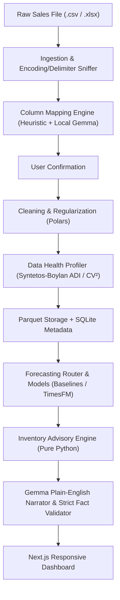

# System Architecture

## Overview
The Demand Forecasting & Inventory Advisor is a local-first sales forecasting and inventory advisor application designed for small retailers and online merchants. It runs entirely on local host hardware, ensuring private business sales data never leaves the premises.

## Core Subsystems

### 1. Ingestion & Preprocessing
- **Sniffing:** Detects character encoding (UTF-8, Latin-1/ISO-8859-1) and delimiter format (`,`, `;`, `\t`, `|`).
- **Streaming Storage:** Saves raw input file unaltered into `data/uploads/`.
- **Column Mapping:** Heuristic scoring maps source headers to logical schema fields (`date`, `product`, `quantity`, `revenue`, `store`, `promo_flag`, `stock_on_hand`).
- **Cleaning & Regularization:**
  - Robust date parsing resolving day-first vs. month-first ambiguity.
  - Negative quantity separation as return events.
  - Active-period zero filling: gaps between first and last observed sale of each product are filled with zeros; leading periods prior to first sale are left unpadded.
  - Outlier detection via IQR multiplier ($3 \times \text{IQR}$).
  - Output written to disk as Apache Parquet (`data/parquet/{id}.parquet`).

### 2. Time-Series Profiling
- Classifies each product into exactly one demand pattern:
  - `inactive`: No sales in the last 60 days.
  - `short_history`: Fewer than 60 daily (or 8 weekly) periods.
  - `smooth`: $\text{ADI} < 1.32$ and $CV^2 < 0.49$.
  - `erratic`: $\text{ADI} < 1.32$ and $CV^2 \ge 0.49$.
  - `intermittent`: $\text{ADI} \ge 1.32$ and $CV^2 < 0.49$.
  - `lumpy`: $\text{ADI} \ge 1.32$ and $CV^2 \ge 0.49$.
- Produces a structured Data Health Report with plain-English problem explanations and resolutions.

### 3. Forecasting & Backtesting (Phases 2 & 3)
- Models: Naive, Seasonal Naive, ETS/AutoARIMA, Croston/SBA/TSB, and Google TimesFM.
- Rolling-origin backtesting with MASE, WAPE, pinball loss, and prediction interval coverage.

### 4. Inventory Advice (Phase 2)
- Reorder points ($ROP$), safety stock, recommended order quantities respecting MOQ and pack sizes.
- Deterministic calculation with zero AI hallucination.

### 5. Insights & Narration (Phase 4)
- Local Gemma LLM via Ollama generating plain-English summaries from a facts JSON.
- Numeric validator rejecting any sentence with numbers not found in the ground truth facts.
